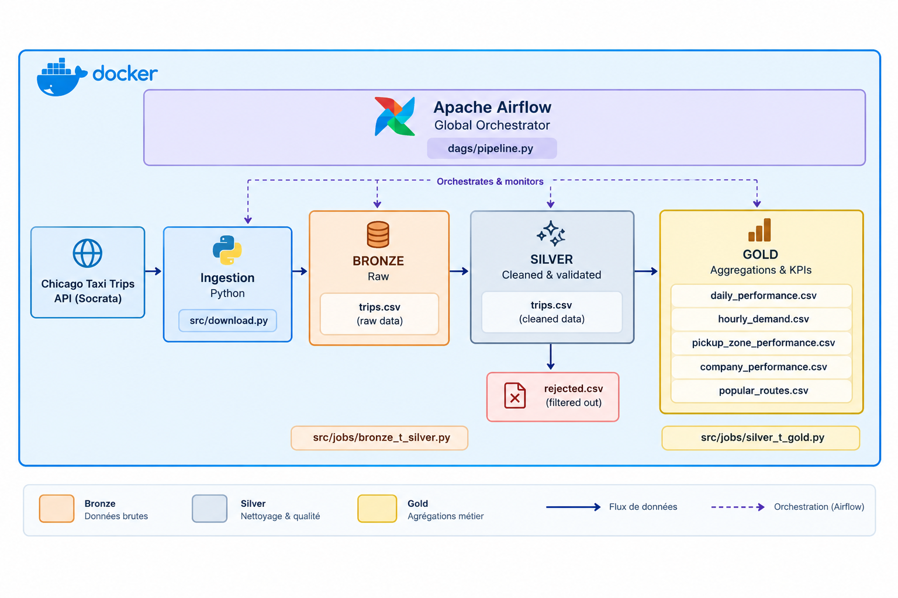

# Chicago Taxi Trips — Data Engineering Pipeline

## 1. Prérequis et lancement

### Prérequis

- Docker Desktop avec Docker Compose
- Git

### Étapes de lancement

**1. Cloner le dépôt**

```bash
git clone https://github.com/oussama6khattabi/Artefact-DE-use-case.git
cd Artefact-DE-use-case
```

**2. Démarrer Docker Desktop**, puis construire l’image et lancer les services :

```bash
docker compose build
docker compose up -d
```

**3. Créer l’utilisateur administrateur Airflow**

Réinitialiser le mot de passe du user (admin) :

```bash
docker compose exec airflow airflow users reset-password \
  --username admin \
  --password admin
```


**4. Accéder à Airflow**

Ouvrir [http://localhost:8080](http://localhost:8080), puis se connecter avec `admin` / `admin`.

Activer le DAG du pipeline si nécessaire, puis déclencher une exécution manuelle.

**5. Vérifier l’exécution et les résultats**


Les résultats sont disponibles dans les répertoires `data/bronze`, `data/silver` et `data/gold`.


## 2. Structure du projet

```text
.
├── dags/
│   └── pipeline.py   # Orchestration Airflow
├── src/
│   ├── download.py                # Extraction depuis l’API
│   └── jobs/
│       ├── bronze_t_silver.py    # Nettoyage et qualité des données
│       └── silver_t_gold.py      # Agrégations métier
├── data/
│   ├── bronze/                    # Données brutes
│   ├── silver/                    # Données nettoyées et rejets
│   └── gold/                      # Indicateurs analytiques
├── Dockerfile                     # Image avec les dépendances
├── compose.yaml                   # Services Docker
└── README.md
```

## 3. Schéma d’architecture

<p align="center">
  
</p>

- **Bronze — Raw :** conserve les données extraites de la source.
- **Silver — Cleaned :** convertit les types, rejette les lignes invalides avec leur motif, déduplique les trajets et crée des variables analytiques comme la date, l’heure, la durée et la vitesse.
- **Gold — Curated :** produit les agrégations métier utilisées pour l’analyse et le reporting.

## 4. Choix techniques et arbitrages
- **Periode choisie :** 15 decembre 2022 - 30 decembre 2022.
- **Python et l’API Socrata :** pagination et filtrage temporel pour maîtriser le volume téléchargé.
- **Apache Airflow :** orchestration des tâches, gestion des dépendances et suivi des exécutions.
- **Docker Compose :** environnement reproductible sans installation locale de Java ou Spark.


## 5. Agrégations Gold

Chaque agrégation est écrite dans un fichier CSV distinct.

| Fichier | Granularité | Indicateurs et objectif |
|---|---|---|
| `daily_performance.csv` | Par date | Nombre de trajets, revenu total, valeur moyenne d’un trajet, durée moyenne, distance moyenne, vitesse moyenne et pourcentage moyen de pourboire. Permet de suivre l’évolution quotidienne de l’activité. |
| `hourly_demand.csv` | Par heure de prise en charge | Nombre de trajets, revenu total, valeur moyenne d’un trajet et durée moyenne. Permet d’identifier les heures de pointe et les périodes de faible demande. |
| `pickup_zone_performance.csv` | Par zone communautaire de départ | Nombre de trajets, revenu total, valeur moyenne, distance moyenne et pourcentage moyen de pourboire. Permet de comparer les zones de prise en charge. |
| `company_performance.csv` | Par compagnie | Nombre de trajets, revenu total, valeur moyenne, durée moyenne, pourcentage moyen de pourboire et vitesse moyenne. Permet de comparer l’activité entre compagnies. |
| `popular_routes.csv` | Par couple zone de départ–zone d’arrivée | Nombre de trajets, revenu total, distance moyenne et durée moyenne. Permet d’identifier les itinéraires les plus fréquentés et leur poids économique. |


## 6. Avec plus de temps

- **Assistant IA de recommandation pour les chauffeurs de taxi :** un outil qui analyse l'historique des courses (zones, horaires, tarifs) et conseille en temps réel chaque chauffeur pour qu'il gagne plus et roule moins à vide.
- **Fonctionnalité 1 : zone à privilégier.** Après chaque course, l'outil indique la zone où se rendre dans les 15 prochaines minutes pour trouver la course la plus rentable, en tenant compte de la distance à parcourir.
- **Fonctionnalité 2 : prévision des heures de pointe.** L'outil annonce les périodes de forte demande de la journée et de la semaine par quartier, pour aider le chauffeur à planifier son shift.
- **Déploiement sur le cloud (AWS, GCP ou Azure) :** stockage objet pour le data lake, Spark et Airflow managés, avec une puissance de calcul qui s'adapte à la charge au lieu d'être limitée à une seule machine.
- **Exploitation de tout l'historique (2013-2023) :** traiter les dix années de courses au lieu de 15 jours, pour capter les saisons, les jours fériés et les événements, et obtenir des recommandations bien plus fiables.
- **Dashboard Power BI :** carte de la demande, zones recommandées par heure et évolution de l'activité.
- **Tests :** ajouter des tests unitaires et d’intégration pour l’ingestion, les règles de qualité et les agrégations.
- **Robustesse :** renforcer la gestion des erreurs API, la pagination, les reprises et l’idempotence des exécutions.
- **Performance :** utiliser Parquet ou Delta pour les données intermédiaires et éviter `collect()` sur de gros volumes.
