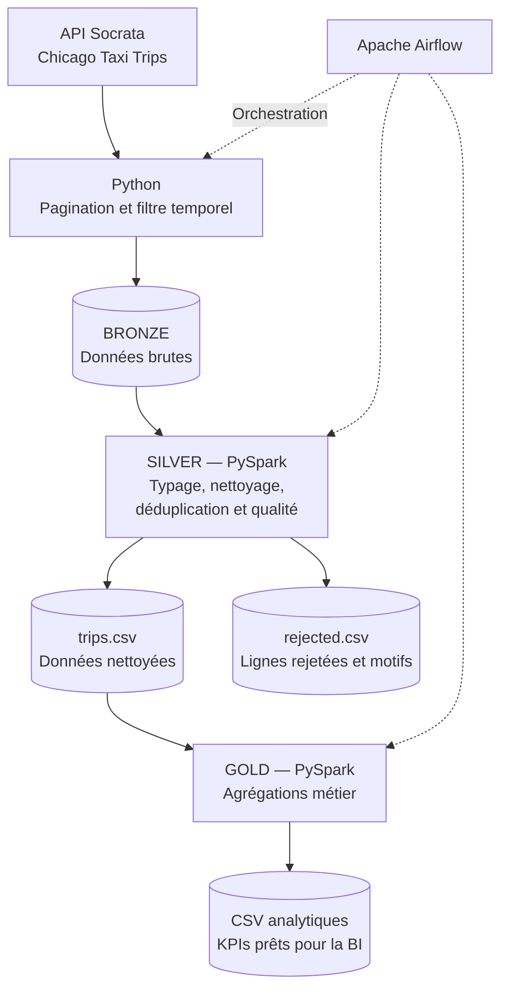

# Chicago Taxi Trips — Data Engineering Pipeline

## 1. Prérequis et lancement

### Prérequis

- Docker Desktop avec Docker Compose
- Git

### Étapes de lancement

**1. Cloner le dépôt**

```bash
git clone https://github.com/artefactory-ma/test_technique_data_engineer_ma.git
cd test_technique_data_engineer_ma
```

**2. Démarrer Docker Desktop**, puis construire l’image et lancer les services :

```bash
docker compose build
docker compose up -d
```

**3. Créer l’utilisateur administrateur Airflow**

```bash
docker compose exec airflow airflow users create \
  --username admin \
  --password admin \
  --firstname Admin \
  --lastname User \
  --role Admin \
  --email admin@example.com
```

Si l’utilisateur existe déjà, réinitialiser son mot de passe :

```bash
docker compose exec airflow airflow users reset-password \
  --username admin \
  --password admin
```

Ces commandes supposent que le service Docker Compose s’appelle `airflow`.

**4. Accéder à Airflow**

Ouvrir [http://localhost:8080](http://localhost:8080), puis se connecter avec `admin` / `admin`.

Activer le DAG du pipeline si nécessaire, puis déclencher une exécution manuelle.

**5. Vérifier l’exécution et les résultats**

```bash
docker compose ps
docker compose logs -f airflow
```

Les résultats sont disponibles dans les répertoires `data/bronze`, `data/silver` et `data/gold`, selon les volumes configurés dans `compose.yaml`.

Pour arrêter les services :

```bash
docker compose down
```

> **Note :** `admin/admin` est réservé au développement local. Utiliser des identifiants sécurisés dans tout environnement partagé ou de production.

## 2. Structure du projet

```text
.
├── dags/
│   └── chicago_taxi_pipeline.py   # Orchestration Airflow
├── src/
│   ├── download.py                # Extraction depuis l’API Socrata
│   └── jobs/
│       ├── bronze_to_silver.py    # Nettoyage et qualité des données
│       └── silver_to_gold.py      # Agrégations métier
├── data/
│   ├── bronze/                    # Données brutes
│   ├── silver/                    # Données nettoyées et rejets
│   └── gold/                      # Indicateurs analytiques
├── Dockerfile                     # Image avec les dépendances
├── compose.yaml                   # Services Docker
└── README.md
```

## 3. Schéma d’architecture



- **Bronze — Raw :** conserve les données extraites de la source.
- **Silver — Cleaned :** convertit les types, rejette les lignes invalides avec leur motif, déduplique les trajets et crée des variables analytiques comme la date, l’heure, la durée et la vitesse.
- **Gold — Curated :** produit les agrégations métier utilisées pour l’analyse et le reporting.

## 4. Choix techniques et arbitrages

- **Python et l’API Socrata :** pagination et filtrage temporel pour maîtriser le volume téléchargé.
- **PySpark :** transformations déclaratives, typage explicite et agrégations réutilisables.
- **Apache Airflow :** orchestration des tâches, gestion des dépendances et suivi des exécutions.
- **Docker Compose :** environnement reproductible sans installation locale de Java ou Spark.
- **Gestion des rejets :** les erreurs bloquantes sont isolées dans `rejected.csv`. Les anomalies non bloquantes sont signalées afin de préserver les données potentiellement utiles.
- **CSV unique par sortie :** format simple à inspecter et à livrer. L’utilisation de `collect()` facilite l’écriture d’un fichier unique, mais rapatrie les données en mémoire côté pilote ; elle n’est donc adaptée qu’à des volumes limités.

La déduplication repose sur `trip_id`, supposé identifier un trajet de manière unique.

## 5. Agrégations Gold

Chaque agrégation est écrite dans un fichier CSV distinct.

| Fichier | Granularité | Indicateurs et objectif |
|---|---|---|
| `daily_performance.csv` | Par date | Nombre de trajets, revenu total, valeur moyenne d’un trajet, durée moyenne, distance moyenne, vitesse moyenne et pourcentage moyen de pourboire. Permet de suivre l’évolution quotidienne de l’activité. |
| `hourly_demand.csv` | Par heure de prise en charge | Nombre de trajets, revenu total, valeur moyenne d’un trajet et durée moyenne. Permet d’identifier les heures de pointe et les périodes de faible demande. |
| `pickup_zone_performance.csv` | Par zone communautaire de départ | Nombre de trajets, revenu total, valeur moyenne, distance moyenne et pourcentage moyen de pourboire. Permet de comparer les zones de prise en charge. |
| `company_performance.csv` | Par compagnie | Nombre de trajets, revenu total, valeur moyenne, durée moyenne, pourcentage moyen de pourboire et vitesse moyenne. Permet de comparer l’activité entre compagnies. |
| `popular_routes.csv` | Par couple zone de départ–zone d’arrivée | Nombre de trajets, revenu total, distance moyenne et durée moyenne. Permet d’identifier les itinéraires les plus fréquentés et leur poids économique. |

**Définitions :**
- Le revenu est calculé à partir de `trip_total`.
- Le pourcentage de pourboire est calculé comme `tips / fare × 100`, uniquement lorsque `fare` est positif.
- Les zones ou compagnies manquantes doivent être interprétées comme des valeurs inconnues, et non comme des catégories métier réelles.

## 6. Avec plus de temps

- **Tests :** ajouter des tests unitaires et d’intégration pour l’ingestion, les règles de qualité et les agrégations.
- **Robustesse :** renforcer la gestion des erreurs API, la pagination, les reprises et l’idempotence des exécutions.
- **Performance :** utiliser Parquet ou Delta pour les données intermédiaires et éviter `collect()` sur de gros volumes.
- **Observabilité :** suivre les volumes extraits, nettoyés et rejetés, la durée des tâches et les erreurs.
- **Industrialisation :** mettre en place CI/CD, une gestion sécurisée des secrets et un déploiement Airflow adapté à la production.
