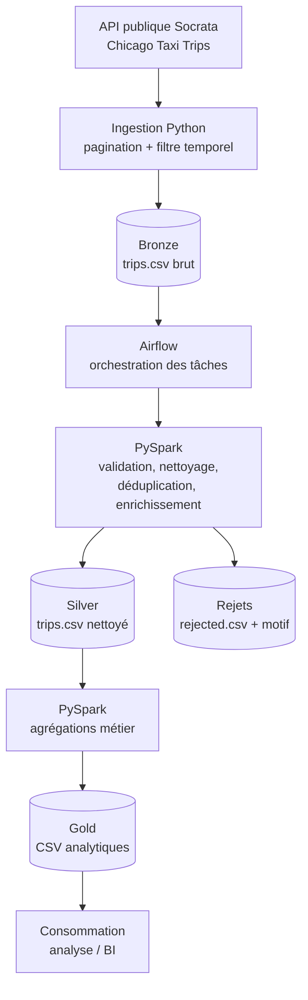

# Chicago Taxi Trips — Data Engineering Pipeline

## 1. Présentation

Ce projet met en place un pipeline de traitement de données pour les trajets de taxis de Chicago. Il récupère les données depuis l’API publique de Chicago, les stocke dans une zone **Bronze**, les nettoie et les enrichit dans une zone **Silver**, puis produit des agrégations métier dans une zone **Gold**.

L’orchestration est assurée par **Apache Airflow**, tandis que les transformations sont réalisées avec **PySpark**. L’environnement est lancé avec **Docker Compose** afin de limiter les dépendances à installer sur la machine hôte.

## 2. Prérequis

Installer les éléments suivants :

- **Docker Desktop**, avec Docker Compose, démarré.
- **Git**, si le dépôt doit être cloné.
- Une connexion Internet pour interroger l’API publique Socrata.
- Des ressources suffisantes pour exécuter Airflow et Spark dans des conteneurs.

Aucune installation locale de Python, Java ou Spark n’est nécessaire si ces dépendances sont installées dans l’image Docker du projet.

## 3. Lancement pas à pas

### Étape 1 — Récupérer le projet

```bash
git clone https://github.com/artefactory-ma/test_technique_data_engineer_ma.git
cd test_technique_data_engineer_ma
```

Si le projet est déjà présent localement, se placer simplement à la racine du dépôt.

### Étape 2 — Vérifier la structure

La structure attendue est similaire à celle-ci :

```text
.
├── dags/
│   └── chicago_taxi_pipeline.py
├── src/
│   ├── download.py
│   └── jobs/
│       ├── bronze_to_silver.py
│       └── silver_to_gold.py
├── data/
│   ├── bronze/
│   ├── silver/
│   └── gold/
├── Dockerfile
├── compose.yaml
└── README.md
```

Les noms exacts des fichiers peuvent varier selon l’organisation retenue dans le dépôt. Les chemins de données utilisés par les scripts doivent correspondre aux volumes montés dans `compose.yaml`.

### Étape 3 — Configurer les paramètres

Si l’ingestion utilise des variables d’environnement, définir dans `compose.yaml` ou dans un fichier `.env` les dates de début et de fin, ainsi que la taille de page de l’API. Exemple :

```env
START_DATE=2023-01-01T00:00:00
END_DATE=2023-01-02T00:00:00
PAGE_LIMIT=50000
```

La période est volontairement configurable afin de faciliter les tests et de maîtriser le volume téléchargé. Adapter les noms des variables à ceux réellement lus par `download.py`.

### Étape 4 — Construire l’image et démarrer les services

À la racine du projet :

```bash
docker compose build
docker compose up -d
```

Vérifier l’état du conteneur :

```bash
docker compose ps
docker compose logs -f airflow
```

Si le service Airflow porte un autre nom dans `compose.yaml`, remplacer `airflow` par le nom réel du service.

### Étape 5 — Ouvrir Airflow

Ouvrir [http://localhost:8080](http://localhost:8080).

Avec une configuration Airflow Standalone, les identifiants initiaux sont généralement affichés dans les logs du conteneur ou stockés dans le fichier `standalone_admin_password.txt` du conteneur. Si le projet définit explicitement un utilisateur et un mot de passe, utiliser ces valeurs.

### Étape 6 — Exécuter le pipeline

Dans l’interface Airflow :

1. Repérer le DAG du pipeline Chicago Taxi.
2. L’activer si nécessaire.
3. Déclencher une exécution manuelle.
4. Consulter les logs de chaque tâche pour vérifier l’ingestion, le nettoyage et les agrégations.

Le flux attendu est :

```text
download_to_bronze >> bronze_to_silver >> silver_to_gold
```

### Étape 7 — Vérifier les résultats

Les fichiers sont écrits dans le répertoire `data/` de l’hôte, si ce répertoire est bien monté dans le conteneur :

```text
data/
├── bronze/
│   └── trips.csv
├── silver/
│   ├── trips.csv
│   └── rejected.csv
└── gold/
    ├── daily_performance.csv
    ├── hourly_demand.csv
    ├── pickup_zone_performance.csv
    ├── company_performance.csv
    └── popular_routes.csv
```

Les fichiers Gold correspondent aux agrégations configurées dans `silver_to_gold.py`. Si les noms diffèrent dans le code, se référer aux chemins définis dans ce script.

### Arrêter l’environnement

```bash
docker compose down
```

Pour supprimer également les volumes Docker persistants (par exemple les métadonnées Airflow), utiliser `docker compose down -v`. **Attention :** cette commande supprime les données stockées dans ces volumes.

## 4. Schéma d’architecture



Airflow orchestre les étapes et leurs dépendances ; il ne réalise pas lui-même les transformations. Python gère l’appel à l’API, et Spark traite les données dans les étapes Silver et Gold.

## 5. Choix techniques et arbitrages

### Python et l’API Socrata

- Utilisation de Python pour appeler l’API et gérer la pagination.
- Filtrage temporel côté source pour limiter le volume transféré.
- Pagination par offset/limit afin de récupérer plusieurs pages.
- L’ordre des résultats doit être stable pendant la pagination ; lorsque c’est possible, utiliser un ordre basé sur des colonnes stables telles que l’identifiant et l’horodatage.

**Arbitrage :** cette approche reste simple et adaptée à un exercice technique. Pour un flux de très grande taille ou une source qui évolue pendant l’extraction, une stratégie d’incrément plus robuste serait préférable.

### Architecture Medallion

- **Bronze :** données récupérées depuis la source, avec un minimum de transformations afin de préserver une copie exploitable de l’entrée.
- **Silver :** typage, validation, déduplication et création de colonnes utiles à l’analyse.
- **Gold :** agrégations orientées métier pour faciliter la consommation analytique.

Cette séparation rend le traitement plus lisible, facilite le diagnostic des erreurs et permet de réexécuter les transformations sans interroger systématiquement l’API.

### Nettoyage et qualité des données

La couche Silver :

- convertit les dates et mesures numériques ;
- écarte de la sortie Silver les lignes présentant des erreurs bloquantes, par exemple un identifiant manquant, un horodatage de départ invalide, des montants ou mesures négatifs, ou une fin antérieure au début ;
- conserve les lignes rejetées dans un fichier séparé avec un motif explicatif ;
- déduplique les trajets à partir de `trip_id` ;
- ajoute des indicateurs tels que la date du trajet, l’heure de départ, la durée en minutes, la vitesse moyenne, le pourcentage de pourboire et le revenu par mile ;
- signale certaines anomalies non nécessairement bloquantes via `data_quality_flag`.

**Arbitrage :** les anomalies qui peuvent être informatives sont signalées plutôt que supprimées automatiquement. Par exemple, une durée nulle ou une distance nulle mérite une analyse, mais ne suffit pas toujours à conclure que le trajet est inutilisable. Les règles de rejet doivent être ajustées à la qualité réelle des données et aux exigences métier.

La déduplication par `trip_id` est une règle simple. Si la source contient plusieurs versions légitimes d’un même identifiant, il faudrait une règle déterministe fondée sur un horodatage de mise à jour ou une autre information métier.

### PySpark

PySpark a été choisi pour structurer les transformations dans un moteur adapté au traitement distribué, même si le volume utilisé pour les tests peut être traité sur une seule machine.

Les colonnes sont typées explicitement et les agrégations sont réalisées avec les fonctions Spark SQL. Cela rend les traitements plus déclaratifs et facilite leur évolution.

### Airflow et Docker Compose

- **Airflow** gère les dépendances, les relances et les logs des tâches.
- **Docker Compose** fournit un environnement reproductible et réduit les problèmes liés aux différences entre postes de développement.
- Les répertoires de données sont montés dans le conteneur afin de rendre les sorties accessibles depuis l’hôte.

### Sorties CSV uniques

Pour cet exercice, chaque sortie est matérialisée sous forme d’un fichier CSV unique. Le code peut utiliser `collect()` puis le module `csv` de Python pour écrire ce fichier.

**Arbitrage et limite :** cette méthode répond à une exigence de livrables CSV faciles à consulter, mais `collect()` rapatrie toutes les lignes en mémoire côté pilote. Elle est acceptable uniquement pour un jeu de données limité ou des agrégations de petite taille. Pour un volume important, il vaut mieux laisser Spark écrire en parallèle, produire un dossier CSV avec plusieurs part-files, ou mettre en place une stratégie contrôlée de fusion des fichiers.

Les fichiers Gold sont des agrégats tels que la performance journalière, la demande par heure, la performance par zone de prise en charge, les indicateurs par compagnie et les itinéraires populaires. Le chiffre d’affaires est calculé à partir de `trip_total`, tandis que les pourcentages de pourboire sont calculés à partir de `tips / fare` lorsque `fare` est positif.

## 6. Améliorations possibles avec plus de temps

1. **Tests automatisés :** ajouter des tests unitaires pour les règles de qualité, les calculs dérivés, les doublons et les agrégations, ainsi que des tests d’intégration du DAG.
2. **Qualité de données formalisée :** définir des règles explicites, mesurer les taux de rejet et de nullité, et publier un rapport qualité à chaque exécution.
3. **Incrémental et reprise :** rendre l’ingestion idempotente, enregistrer le dernier intervalle traité et gérer les relances sans dupliquer les données.
4. **Pagination plus robuste :** traiter les limites de l’API, les erreurs HTTP, le backoff exponentiel, les réponses incomplètes et les changements de données pendant l’extraction.
5. **Stockage analytique :** privilégier Parquet ou Delta pour les zones Bronze/Silver/Gold, avec CSV uniquement comme format d’export si nécessaire.
6. **Évolutivité :** éviter `collect()` sur la totalité de Silver ; partitionner les données et limiter la collecte aux petits agrégats.
7. **Observabilité :** ajouter des métriques sur le nombre de lignes extraites, nettoyées et rejetées, la durée des tâches et les volumes traités.
8. **Sécurité et configuration :** sortir les secrets et paramètres sensibles du code, utiliser des variables d’environnement ou un gestionnaire de secrets, et appliquer le principe du moindre privilège.
9. **Optimisation Spark :** analyser les plans d’exécution, choisir les partitions appropriées et mesurer les performances avant de modifier le partitionnement ou la stratégie de jointure.
10. **CI/CD :** ajouter linting, tests, validation du DAG et construction de l’image dans un pipeline d’intégration continue.
11. **Gouvernance et traçabilité :** documenter le schéma, la provenance, les règles de transformation et la version des données traitées.
12. **Déploiement de production :** remplacer l’environnement Airflow Standalone de développement par un déploiement adapté, avec une base de métadonnées dédiée, une gestion robuste des logs et une stratégie de supervision.

## 7. Limites connues

- Les chemins `/opt/airflow/data/...` supposent que le volume `./data:/opt/airflow/data` est défini dans Compose.
- Les variables d’environnement de date et de pagination doivent correspondre aux noms réellement utilisés par le script d’ingestion.
- La déduplication sur `trip_id` suppose que cet identifiant représente un trajet unique.
- Les sorties CSV uniques et l’utilisation de `collect()` sont adaptées à un prototype de taille maîtrisée, pas à une table Silver volumineuse.
- Les indicateurs de qualité sont des règles de départ et doivent être validés avec les besoins métier.

## 8. Conclusion

Le projet propose un pipeline de données de bout en bout, orchestré et reproductible, qui sépare les données brutes, les données nettoyées et les agrégations analytiques. Les principaux compromis visent à conserver une implémentation simple et facile à exécuter dans le cadre d’un test technique, tout en identifiant les évolutions nécessaires pour une utilisation en production.
